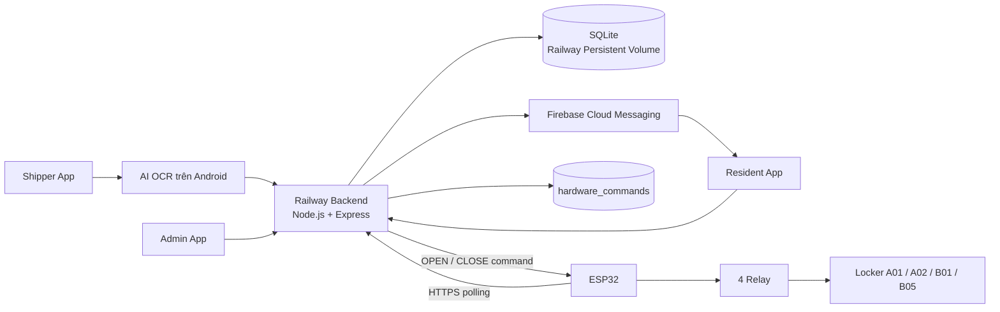

# 🔐 SmartLocker — Intelligent Parcel Locker System

SmartLocker là hệ thống **tủ nhận hàng thông minh** dành cho mô hình chung cư/ký túc xá. Phiên bản hiện tại kết hợp 4 phần chính:

- **Ứng dụng Android React Native** cho Shipper, Cư dân và Admin.
- **Backend Node.js/Express trên Railway** quản lý tài khoản, kiện hàng, OTP, lịch sử và lệnh phần cứng.
- **AI OCR PP-OCRv6 + ONNX Runtime** để đọc bill và chọn số điện thoại người nhận.
- **ESP32 + relay** để điều khiển mở/đóng 4 tủ vật lý.

> README này mô tả **luồng hiện tại của gói `SmartLocker_Full_Project_Organized(4)`**. Các luồng cũ như Shipper không cần đăng nhập, QR nhận hàng hoặc AI chạy chủ yếu ở JavaScript không còn là kiến trúc chính của phiên bản này.

---

## 1. Tổng quan hệ thống

Hệ thống hiện sử dụng 3 vai trò:

### 🚚 Shipper

- Đăng ký bằng số điện thoại, mật khẩu và **mã đăng ký Shipper**.
- Bắt buộc đăng nhập trước khi tạo đơn.
- Chụp bill bằng camera hoặc nhập số điện thoại người nhận thủ công.
- AI OCR đọc bill và tự chọn SĐT người nhận.
- Có thể kiểm tra/sửa SĐT trước khi gửi.
- Backend kiểm tra tài khoản Cư dân, tự chọn tủ trống và tạo kiện hàng.
- Không được nhận OTP của Cư dân.

### 🏠 Cư dân

- Đăng ký/đăng nhập bằng số điện thoại và mật khẩu.
- Thiết bị Android được liên kết với Firebase Cloud Messaging.
- Nhận notification khi Shipper tạo đơn.
- Chạm notification để đi đến màn hình nhận hàng tương ứng.
- Xem OTP nhận hàng được backend cấp cho đúng tài khoản.
- Có thể cấp lại OTP khi OTP hết hạn.
- Dùng OTP để yêu cầu mở tủ.
- Trong ESP32 mode, app chờ trạng thái ACK của lệnh phần cứng.

### 👨‍💼 Admin

- Đăng ký bằng mã Admin.
- Xem trạng thái 4 tủ hiện tại.
- Xem kiện hàng đang chiếm từng tủ.
- Xem lịch sử gửi hàng / nhận hàng / mở khẩn cấp.
- Có thể mở khẩn cấp tủ đang có hàng.
- Trong ESP32 mode, Admin có luồng mở relay → chờ ACK → bấm xác nhận để gửi lệnh tắt relay.

---

## 2. Kiến trúc hiện tại



### 4 tủ vật lý hiện dùng

| Locker | GPIO ESP32 | Relay |
|---|---:|---|
| A01 | GPIO 25 | IN1 |
| A02 | GPIO 26 | IN2 |
| B01 | GPIO 27 | IN3 |
| B05 | GPIO 32 | IN4 |

Backend hiện coi cả 4 tủ là size `M`. `C01` và `C02` đã được loại khỏi danh sách cấp tủ mới và Admin overview.

---

## 3. Luồng giao hàng hiện tại

```text
Shipper đăng nhập
        ↓
Chụp bill / nhập SĐT thủ công
        ↓
AI OCR nhận diện SĐT người nhận
        ↓
Shipper kiểm tra và xác nhận SĐT
        ↓
POST /packages
        ↓
Backend kiểm tra tài khoản Cư dân
        ↓
Backend chọn tủ trống trong A01 / A02 / B01 / B05
        ↓
Tạo package + OTP 6 số
        ↓
Lưu OTP dạng hash + mã hóa AES-256-GCM
        ↓
Gửi Firebase notification cho Cư dân
        ↓
Cư dân mở đúng đơn hàng
        ↓
OTP được hiển thị trong app
        ↓
Cư dân bấm MỞ TỦ
        ↓
Backend xác minh OTP
        ↓
ESP32 mode: queue OPEN command
        ↓
ESP32 poll Railway → nhận OPEN → bật đúng relay → ACK
```

Ở `SOFTWARE` mode, backend mô phỏng mở tủ và chuyển package sang `PICKED_UP` ngay sau khi OTP hợp lệ.

Ở `ESP32` mode, backend chỉ chuyển package sang `PICKED_UP` sau khi hoàn tất chu trình phần cứng và nhận ACK `CLOSE` thành công.

---

## 4. AI nhận diện SĐT người nhận

Phiên bản AI stable hiện tại là **Native Speed V3**.

### Kiến trúc AI

```text
Camera / ảnh bill
        ↓
Resize ảnh làm việc
        ↓
Android/Kotlin native preprocessing
        ↓
Auto-deskew ảnh nghiêng
        ↓
PP-OCRv6 Detector V6
        ↓
Các vùng văn bản
        ↓
PP-OCRv6 Recognizer V6 TopK-F32
        ↓
CTC decode
        ↓
Trích xuất candidate SĐT Việt Nam
        ↓
Receiver / Sender semantic anchors
        ↓
Negative context filtering
        ↓
Candidate Scoring V4
        ↓
R0 fast-path nếu đủ HIGH confidence
        ↓
Fallback 90° / 270° / 180° nếu cần
        ↓
SĐT người nhận
```

### Model hiện dùng

```text
03_AI/SmartLocker_AI_Full_Current/02_Models_Current_Stable/
├── model1_detector_V6.onnx
├── model2_recognizer_V6_TopK_F32.onnx
└── ppocr_keys.txt
```

### Phân chia xử lý

- **Kotlin native** xử lý phần nặng: đọc ảnh, auto-deskew, detector, recognizer và ONNX inference.
- **TypeScript** xử lý logic lựa chọn SĐT: chuẩn hóa candidate, phân tích ngữ cảnh Receiver/Sender, loại hotline/mã vận đơn và chấm điểm V4.
- ONNX Runtime Android được dùng qua native module `SmartLockerOcrNativeModule.kt`.

### Một số nguyên tắc chọn SĐT

Hệ thống ưu tiên ngữ cảnh như:

```text
Người nhận
Receiver
Recipient
Consignee
Đến / Giao đến
```

và giảm/loại candidate xuất hiện gần:

```text
Người gửi
Sender
Hotline
CSKH
Tổng đài
Mã vận đơn
Mã đơn hàng
Tracking
Order ID
```

SĐT được kiểm tra theo định dạng di động Việt Nam và hỗ trợ chuẩn hóa từ `+84...` về `0...`.

### Tối ưu tốc độ hiện tại

- Auto-deskew native cho bill bị nghiêng.
- Recognizer chạy batch lớn hơn để giảm số lần `session.run`.
- TopK-F32 giảm dữ liệu đầu ra recognizer.
- Fast-path dừng ở góc `0°` khi kết quả V4 đã đủ tin cậy.
- Chỉ chạy thêm các góc xoay khi kết quả chưa đủ chắc chắn.

Thời gian thực tế phụ thuộc thiết bị, số lượng text box, độ rõ và góc chụp của bill.

---

## 5. Backend

Backend sử dụng:

- Node.js
- Express.js
- SQLite (`better-sqlite3`)
- JWT Authentication
- bcryptjs
- Firebase Admin SDK
- Railway Persistent Volume

### Các bảng chính

```text
users

devices

packages

activity_logs

hardware_commands
```

### Trạng thái package

```text
READY
PICKED_UP
CANCELLED
```

### Trạng thái hardware command

```text
PENDING
CLAIMED
DONE
FAILED
```

Hardware command hỗ trợ 2 action:

```text
OPEN
CLOSE
```

---

## 6. OTP nhận hàng

OTP hiện là mã **6 chữ số** và có thời gian hết hạn.

Backend không trả OTP cho Shipper. Với đơn mới, OTP không được lưu plaintext trong database mà được lưu theo hai mục đích:

- HMAC-SHA256 để xác minh OTP.
- AES-256-GCM để backend có thể trả OTP cho đúng Cư dân khi đơn còn hợp lệ.

Khi OTP hết hạn, Cư dân có thể yêu cầu cấp lại qua API.

---

## 7. Firebase Notification

Firebase Cloud Messaging được dùng để gửi thông báo khi có kiện hàng mới.

```text
Shipper tạo đơn
      ↓
Railway Backend
      ↓
Firebase Admin SDK
      ↓
Firebase Cloud Messaging
      ↓
Thiết bị Android của Cư dân
```

App có xử lý notification khi:

- đang chạy;
- chạy background;
- được mở từ notification khi app đang đóng.

Khi người dùng bấm notification, app kiểm tra `receiverPhone`. Nếu đang đăng nhập đúng tài khoản Cư dân, app điều hướng đến màn hình nhận hàng. Nếu đang ở tài khoản khác, notification được lưu tạm và yêu cầu chọn đúng tài khoản.

---

## 8. Ghi nhớ nhiều tài khoản

Ứng dụng hỗ trợ lưu nhiều tài khoản đã đăng nhập trong `AsyncStorage` để vào nhanh ở lần mở app sau.

```text
@smartlocker_remembered_accounts_v1
```

Ứng dụng lưu session token của tài khoản đã nhớ nhưng **không lưu mật khẩu** trong màn hình đăng nhập nhanh.

Các role được hỗ trợ:

```text
ADMIN
RESIDENT
SHIPPER
```

---

## 9. ESP32 + Relay

Firmware hiện dùng ESP32 DevKit V1 / ESP32-WROOM-32.

### Nguyên tắc điều khiển relay

```text
LOW  = OFF
HIGH = ON
```

- Khi khởi động: tất cả relay ở trạng thái OFF.
- `OPEN`: chỉ bật relay tương ứng với locker và **giữ ON**.
- ESP32 không tự tắt relay theo timer.
- `CLOSE`: backend gửi lệnh riêng để tắt relay tương ứng.
- ESP32 poll Railway khoảng mỗi `1.2 giây`.
- ESP32 ACK kết quả thực thi về backend.
- Nếu mất Wi-Fi trong lúc relay đang ON, firmware giữ nguyên trạng thái relay và tiếp tục chờ `CLOSE` sau khi kết nối lại.

### Giao tiếp phần cứng

ESP32 dùng HTTPS tới backend Railway và xác thực bằng:

```text
x-device-key
x-device-id
```

Các endpoint phần cứng chính:

```text
GET  /hardware/ping
GET  /hardware/commands/next
POST /hardware/commands/:commandId/complete
```

---

## 10. API chính

### Authentication

```text
POST /auth/register
POST /auth/login
GET  /auth/me
```

### Device / Firebase

```text
POST /devices/register
GET  /devices/me
```

### Package / Resident

```text
POST /packages
GET  /packages/my
POST /packages/:packageId/otp/refresh
POST /packages/:packageId/redeem
```

### Hardware app-side

```text
GET  /hardware/commands/:commandId/status
POST /hardware/packages/:packageId/close
```

### ESP32

```text
GET  /hardware/ping
GET  /hardware/commands/next
POST /hardware/commands/:commandId/complete
```

### Admin

```text
GET  /admin/overview
GET  /admin/history
POST /admin/packages/:packageId/force-open
```

### Health check

```text
GET /health
```

---

## 11. Cấu trúc repository

```text
SmartLocker_Full_Project/
│
├── 00_INDEX/
│   ├── FILE_MANIFEST.csv
│   ├── FOLDER_TREE.txt
│   └── README_PROJECT_STRUCTURE.txt
│
├── 01_Hardware_ESP32/
│   ├── Firmware/
│   │   └── SmartLockerESP32.ino
│   └── Config/
│       └── secrets.h
│
├── 02_Software/
│   ├── Backend/
│   │   ├── server.js
│   │   ├── database.js
│   │   ├── package.json
│   │   ├── package-lock.json
│   │   ├── .env
│   │   └── .env.example
│   │
│   └── Mobile_App/
│       ├── App.tsx
│       ├── package.json
│       ├── src/
│       │   ├── ai/
│       │   │   └── smartlockerOcr.ts
│       │   ├── config/
│       │   │   └── api.ts
│       │   ├── context/
│       │   │   ├── AuthContext.tsx
│       │   │   └── LockerContext.tsx
│       │   ├── navigation/
│       │   │   └── AppNavigator.tsx
│       │   ├── services/
│       │   │   ├── authApi.ts
│       │   │   └── firebaseMessaging.ts
│       │   └── screens/
│       │       ├── HomeScreen.tsx
│       │       ├── LoginScreen.tsx
│       │       ├── RegisterScreen.tsx
│       │       ├── ShipperScreen.tsx
│       │       ├── ResidentScreen.tsx
│       │       ├── AdminScreen.tsx
│       │       └── HistoryScreen.tsx
│       └── android/
│           └── ...
│
└── 03_AI/
    ├── 00_Original_Archive/
    └── SmartLocker_AI_Full_Current/
        ├── 00_README/
        ├── 01_Training/
        ├── 02_Models_Current_Stable/
        ├── 03_App_AI_Current_Stable/
        ├── 04_Evaluation/
        ├── 05_Documentation/
        └── 06_Benchmark_Evidence/
```

`00_INDEX/FILE_MANIFEST.csv` chứa nguồn gốc file, vị trí sau khi tổ chức, kích thước và SHA-256 để đối chiếu.

---

## 12. Cấu hình Backend

Tạo biến môi trường tương ứng với `02_Software/Backend/.env.example`.

Ví dụ cấu hình an toàn:

```env
PORT=3000
JWT_SECRET=CHANGE_ME_TO_A_LONG_RANDOM_SECRET
ADMIN_REGISTER_CODE=CHANGE_ME
SHIPPER_REGISTER_CODE=CHANGE_ME
OTP_TTL_MINUTES=15

# Local Firebase
FIREBASE_SERVICE_ACCOUNT_PATH=./firebase-service-account.json

# Railway có thể dùng raw JSON hoặc Base64
# FIREBASE_SERVICE_ACCOUNT_JSON={...}
# FIREBASE_SERVICE_ACCOUNT_BASE64=...

# ESP32 mode
HARDWARE_MODE=ESP32
ESP_DEVICE_KEY=CHANGE_ME_TO_A_LONG_RANDOM_DEVICE_KEY
ESP_DEVICE_ID=ESP32-LOCKER-01
HARDWARE_COMMAND_STALE_SECONDS=30

# Optional
# DB_PATH=/data/smartlocker.db
```

Trên Railway nên cấu hình các giá trị bí mật bằng **Railway Variables**, không commit `.env` thật lên GitHub.

---

## 13. Cấu hình ESP32

Firmware đọc cấu hình từ:

```text
01_Hardware_ESP32/Config/secrets.h
```

Các giá trị cần cấu hình:

```cpp
#define WIFI_SSID "YOUR_WIFI"
#define WIFI_PASSWORD "YOUR_WIFI_PASSWORD"
#define API_BASE_URL "YOUR_BACKEND_URL"
#define ESP_DEVICE_KEY "SAME_KEY_AS_BACKEND"
#define ESP_DEVICE_ID "ESP32-LOCKER-01"
```

`ESP_DEVICE_KEY` trên ESP32 phải trùng với `ESP_DEVICE_KEY` trên Railway/backend.

---

## 14. Chạy Backend local

Yêu cầu Node.js phù hợp với project.

```bash
cd 02_Software/Backend
npm install
npm start
```

Kiểm tra:

```text
GET http://localhost:3000/health
```

Phản hồi thành công có dạng:

```json
{
  "ok": true,
  "service": "smartlocker-backend"
}
```

---

## 15. Mobile App

Mobile app hiện dùng React Native `0.87.1` và hướng đến Android.

Một số thư viện chính:

- React Native Vision Camera
- React Navigation
- AsyncStorage
- React Native Firebase Messaging
- React Native Image Resizer
- Native Android ONNX Runtime integration

> Gói repository được tổ chức cho mục đích lưu trữ/báo cáo và chỉ giữ các source/config quan trọng đã cung cấp. Nếu build từ thư mục `02_Software/Mobile_App`, cần bảo đảm các file boilerplate React Native/Gradle đầy đủ của project gốc cũng có mặt.

Với project React Native đầy đủ:

```bash
npm install
npx react-native start --reset-cache
```

Mở terminal khác:

```bash
npx react-native run-android
```

Do AI hiện có native Kotlin module, khi thay đổi phần Kotlin nên clean Android trước khi build lại.

---

## 16. Railway + SQLite

Backend có thể deploy trên Railway và sử dụng SQLite cùng Persistent Volume.

Khi Railway có volume mount, backend tự nhận biết `RAILWAY_VOLUME_MOUNT_PATH`. Có thể dùng `DB_PATH` nếu muốn ép đường dẫn database.

Các dữ liệu chính được giữ trong SQLite gồm:

- tài khoản;
- FCM device token;
- package;
- OTP metadata;
- lịch sử;
- hardware command.

---

## 17. Trạng thái triển khai phần cứng hiện tại

Backend và firmware đã hỗ trợ đầy đủ mô hình command:

```text
OPEN → relay ON → ESP ACK
CLOSE → relay OFF → ESP ACK → package PICKED_UP
```

Luồng **Admin mở khẩn cấp** trong `AdminScreen.tsx` đã gọi cả OPEN và CLOSE: sau khi ESP32 mở relay, Admin bấm `OK - TẮT RELAY` để gửi lệnh CLOSE.

Trong `ResidentScreen.tsx` của đúng gói source này, màn hình Cư dân hiện đã:

- xác minh OTP;
- gửi yêu cầu OPEN;
- chờ ESP32 ACK `DONE`;
- thông báo mở tủ thành công.

Tuy nhiên màn hình Cư dân **chưa gọi endpoint `/hardware/packages/:packageId/close` sau khi người dùng xác nhận đã lấy hàng**. Backend và firmware đã có sẵn endpoint/logic CLOSE, vì vậy đây là phần cần nối tiếp ở UI Cư dân nếu dùng ESP32 mode hoàn chỉnh ngoài demo.

---

## 18. Lưu ý bảo mật trước khi đưa lên GitHub

**Không push repository công khai khi vẫn còn secret thật.**

Gói hiện tại có các file cấu hình cần kiểm tra/xóa hoặc thay bằng bản mẫu trước khi public:

```text
02_Software/Backend/.env
01_Hardware_ESP32/Config/secrets.h
firebase-service-account.json        # nếu có
smartlocker.db                       # nếu có dữ liệu thật
```

Không commit các giá trị thật của:

```text
JWT_SECRET
ADMIN_REGISTER_CODE
SHIPPER_REGISTER_CODE
ESP_DEVICE_KEY
Wi-Fi password
Firebase private key
```

Nên chỉ giữ `.env.example` và một `secrets.example.h` chứa placeholder trong repository public.

---

## 19. Mục tiêu đề tài

SmartLocker hướng đến mô hình nhận hàng tự động với quy trình:

- xác thực Shipper trước khi tạo đơn;
- dùng AI OCR hỗ trợ lấy SĐT người nhận từ bill;
- backend tự động quản lý tủ và OTP;
- gửi notification cho Cư dân;
- cho phép Cư dân nhận hàng bằng OTP;
- cho phép Admin giám sát và mở khẩn cấp;
- kết nối backend cloud với ESP32 để điều khiển relay/tủ thật.

Dự án được xây dựng phục vụ mục đích **học tập, nghiên cứu và demo đồ án SmartLocker**.

---

## 20. Tài liệu AI trong repository

Nếu cần đọc sâu phần AI, ưu tiên:

```text
03_AI/SmartLocker_AI_Full_Current/00_README/README_AI_FINAL_PACKAGE.txt
03_AI/SmartLocker_AI_Full_Current/05_Documentation/Tong_quan_luong_AI_SmartLocker_trong_App.docx
03_AI/SmartLocker_AI_Full_Current/01_Training/SmartLocker_PP-OCRv6_MC-OCR_FULL_14_CELLS_FIXED_V2.ipynb
03_AI/SmartLocker_AI_Full_Current/03_App_AI_Current_Stable/src/ai/smartlockerOcr.ts
03_AI/SmartLocker_AI_Full_Current/03_App_AI_Current_Stable/android/app/src/main/java/com/smartlockerapp/ai/SmartLockerOcrNativeModule.kt
03_AI/SmartLocker_AI_Full_Current/04_Evaluation/SMARTLOCKER_TEST_FULL_8_CELLS_V4_HYBRID.ipynb
```

---

**SmartLocker — React Native + Railway + Firebase + PP-OCRv6/ONNX + ESP32**
