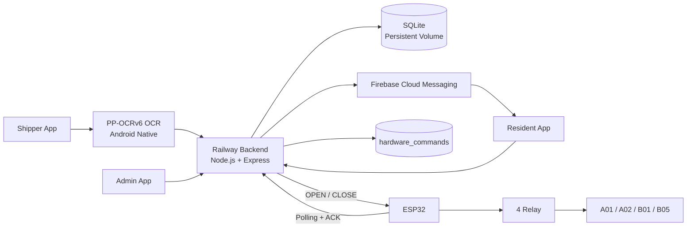
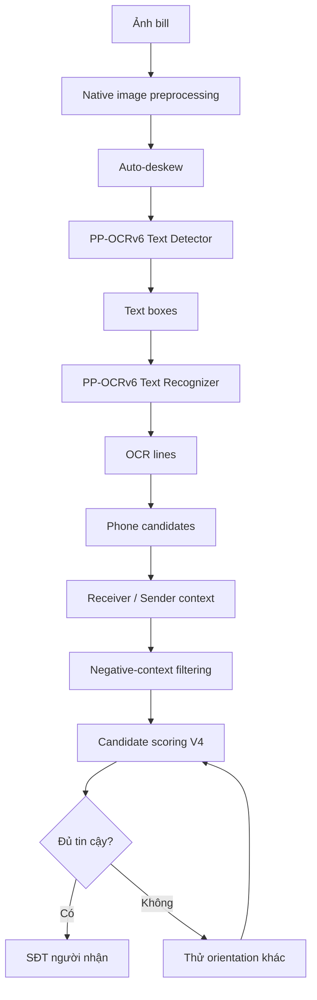

# 🔐 SmartLocker — Intelligent Parcel Locker System

SmartLocker là hệ thống **tủ nhận hàng thông minh** dành cho mô hình chung cư/ký túc xá. Project kết hợp ứng dụng React Native, backend cloud, Firebase Cloud Messaging, AI OCR chạy trực tiếp trên Android và khả năng điều khiển tủ vật lý bằng ESP32 + relay.

Phiên bản hiện tại có 3 vai trò chính:

- **Shipper**: đăng nhập, chụp bill hoặc nhập số điện thoại người nhận, tạo đơn giao hàng.
- **Cư dân**: nhận thông báo, xem OTP, yêu cầu mở tủ và nhận hàng.
- **Admin**: theo dõi trạng thái tủ, lịch sử giao dịch và mở tủ khẩn cấp.

> README này mô tả **code hiện tại của repository `SmartLockerApp`**. Các luồng cũ như Shipper không cần đăng nhập, nhận hàng bằng QR hoặc pipeline OCR TFLite cũ không còn là luồng chính.

---

## 1. Kiến trúc tổng thể



### Thành phần chính

| Thành phần | Công nghệ | Vai trò |
|---|---|---|
| Mobile App | React Native + TypeScript | Giao diện cho Shipper, Cư dân và Admin |
| AI OCR | PP-OCRv6 + ONNX Runtime Android + Kotlin native | Đọc bill và chọn SĐT người nhận |
| Backend | Node.js + Express | Auth, package, OTP, lịch sử, hardware command |
| Database | SQLite + `better-sqlite3` | Lưu user, package, thiết bị, log và lệnh phần cứng |
| Notification | Firebase Cloud Messaging | Thông báo kiện hàng mới cho Cư dân |
| Cloud | Railway | Deploy backend và lưu database bằng Persistent Volume |
| Hardware | ESP32 + relay | Điều khiển mở/đóng tủ vật lý |

---

## 2. Chức năng theo vai trò

### 🚚 Shipper

- Đăng ký bằng số điện thoại, mật khẩu và **mã giới thiệu Shipper**.
- Bắt buộc đăng nhập trước khi sử dụng chức năng giao hàng.
- Chụp ảnh bill bằng camera.
- AI OCR nhận diện SĐT người nhận từ bill.
- Có thể sửa hoặc nhập SĐT thủ công trước khi xác nhận.
- Backend kiểm tra SĐT có thuộc tài khoản Cư dân hay không.
- Backend tự chọn tủ trống phù hợp.
- Tạo kiện hàng và kích hoạt notification cho Cư dân.
- Shipper **không nhận OTP** của người nhận.

### 🏠 Cư dân

- Đăng ký/đăng nhập bằng số điện thoại và mật khẩu.
- Thiết bị được liên kết với Firebase Cloud Messaging.
- Nhận notification khi có kiện hàng mới.
- Chạm notification để vào màn hình nhận hàng.
- Xem OTP của đúng kiện hàng thuộc tài khoản hiện tại.
- Có thể cấp lại OTP khi OTP hết hạn.
- Bấm **MỞ TỦ** để backend xác minh OTP.
- Trong ESP32 mode, app chờ ESP32 ACK trạng thái lệnh mở tủ.

### 👨‍💼 Admin

- Đăng ký bằng mã Admin.
- Theo dõi trạng thái toàn bộ 4 tủ.
- Xem tủ nào đang trống hoặc đang chứa hàng.
- Xem lịch sử gửi hàng, nhận hàng và mở khẩn cấp.
- Mở tủ khẩn cấp khi cần.
- Trong ESP32 mode, Admin có thể thực hiện chu trình **OPEN → ACK → CLOSE → ACK**.

---

## 3. Luồng giao hàng

```text
Shipper đăng nhập
        ↓
Chụp bill / nhập SĐT thủ công
        ↓
AI OCR đọc bill
        ↓
Chọn SĐT người nhận
        ↓
Shipper kiểm tra và xác nhận
        ↓
POST /packages
        ↓
Backend kiểm tra tài khoản Cư dân
        ↓
Backend chọn tủ trống
        ↓
Tạo package + OTP 6 số
        ↓
Lưu package vào SQLite
        ↓
Gửi Firebase notification
        ↓
Cư dân mở app
        ↓
Xem OTP
        ↓
Bấm MỞ TỦ
        ↓
Backend xác minh OTP
        ↓
SOFTWARE mode hoặc ESP32 mode
```

### SOFTWARE mode

Nếu backend chạy với:

```env
HARDWARE_MODE=SOFTWARE
```

sau khi OTP hợp lệ, backend mô phỏng mở tủ và chuyển đơn sang `PICKED_UP`.

### ESP32 mode

Nếu backend chạy với:

```env
HARDWARE_MODE=ESP32
```

backend tạo lệnh phần cứng trong bảng `hardware_commands`:

```text
Resident/Admin yêu cầu mở tủ
        ↓
Backend queue OPEN
        ↓
ESP32 poll Railway
        ↓
ESP32 nhận OPEN
        ↓
Bật relay tương ứng
        ↓
ESP32 ACK DONE / FAILED
```

Backend cũng hỗ trợ lệnh `CLOSE` để tắt relay. Package chỉ được hoàn tất theo chu trình phần cứng khi lệnh đóng được xử lý thành công.

---

## 4. Hệ thống tủ hiện tại

Backend hiện sử dụng 4 locker:

| Locker | Kích thước backend | Relay |
|---|---|---|
| `A01` | M | IN1 |
| `A02` | M | IN2 |
| `B01` | M | IN3 |
| `B05` | M | IN4 |

Trong phiên bản demo hiện tại, cả 4 tủ được cấu hình cùng size `M` để thuận tiện cho việc cấp tủ và kiểm thử.

---

## 5. AI nhận diện SĐT người nhận

Pipeline OCR hiện tại sử dụng **PP-OCRv6 + ONNX Runtime trên Android native**.

### 5.1. Model đang được app sử dụng

Các file model active nằm tại:

```text
android/app/src/main/assets/smartlocker/
├── manifest.json
├── model1_detector.onnx
├── model1_detector_inference.yml
├── model2_recognizer.onnx
├── model2_recognizer_inference.yml
└── ppocr_keys.txt
```

### 5.2. Native module

Phần xử lý nặng được đưa xuống Kotlin:

```text
android/app/src/main/java/com/smartlockerapp/ai/
├── SmartLockerOcrNativeModule.kt
└── SmartLockerOcrNativePackage.kt
```

TypeScript gọi native module thông qua:

```text
src/ai/smartlockerOcr.ts
```

### 5.3. Luồng OCR



### 5.4. Chọn đúng số điện thoại

Hệ thống không lấy chuỗi số đầu tiên OCR được. Sau OCR, `smartlockerOcr.ts` tiếp tục đánh giá ngữ cảnh xung quanh candidate.

Các vùng được ưu tiên gồm:

```text
Người nhận
Receiver
Recipient
Consignee
Đến / To
```

Các vùng bị giảm điểm hoặc loại gồm:

```text
Người gửi
Sender
Hotline
CSKH
Tổng đài
Mã vận đơn
Mã đơn hàng
Tracking
Order ID
```

SĐT được kiểm tra theo định dạng di động Việt Nam và có thể chuẩn hóa từ `+84...` về `0...`.

### 5.5. Tối ưu tốc độ

Pipeline hiện có các tối ưu chính:

- xử lý ảnh và ONNX inference ở Kotlin native;
- auto-deskew cho ảnh bill bị nghiêng;
- recognizer chạy batch;
- recognizer TopK giúp giảm kích thước output;
- ưu tiên góc `0°`;
- nếu kết quả ở `0°` đạt độ tin cậy cao thì dừng sớm;
- nếu chưa chắc chắn mới thử lần lượt `90°`, `270°`, `180°`.

### 5.6. File TFLite cũ

Repository vẫn còn một số model TFLite tại:

```text
assets/
src/assets/
```

Các file này là artifact từ các phiên bản OCR trước. **Luồng OCR hiện tại được mô tả trong README sử dụng PP-OCRv6 ONNX + native Kotlin**, không sử dụng chúng làm pipeline chính.

---

## 6. Firebase Notification

Firebase Cloud Messaging được dùng để thông báo cho Cư dân khi Shipper tạo kiện hàng mới.

```text
Shipper tạo package
        ↓
Railway Backend
        ↓
Firebase Admin SDK
        ↓
Firebase Cloud Messaging
        ↓
Android của Cư dân
```

App xử lý notification ở các trạng thái:

- foreground;
- background;
- mở app từ notification.

Các file chính:

```text
src/services/firebaseMessaging.ts
android/app/google-services.json
```

Firebase **service account private key của backend không được commit lên GitHub**. Backend nhận key thông qua biến môi trường trên Railway hoặc file local không được track.

---

## 7. Authentication và phân quyền

Backend sử dụng JWT và `bcryptjs`.

Các role:

```text
ADMIN
RESIDENT
SHIPPER
```

Một số rule chính:

- `POST /packages`: chỉ `SHIPPER`.
- `GET /packages/my`: chỉ `RESIDENT`.
- `POST /packages/:packageId/redeem`: chỉ `RESIDENT` sở hữu package.
- `/admin/*`: chỉ `ADMIN`.
- Endpoint dành cho ESP32 sử dụng `x-device-key` và `x-device-id` thay cho JWT người dùng.

Ứng dụng cũng hỗ trợ lưu nhiều tài khoản đã đăng nhập bằng `AsyncStorage` để chọn lại nhanh mà không lưu mật khẩu plaintext.

---

## 8. OTP nhận hàng

OTP gồm **6 chữ số** và có thời gian hết hạn.

Đối với package mới, backend không lưu OTP plaintext trong database. OTP được xử lý theo hai mục đích:

- hash để xác minh OTP;
- mã hóa để có thể hiển thị lại cho đúng Cư dân khi còn hiệu lực.

Khi OTP hết hạn, Cư dân có thể yêu cầu cấp lại OTP từ app.

---

## 9. Backend

Backend nằm trực tiếp trong:

```text
backend/
```

Công nghệ chính:

- Node.js
- Express 5
- SQLite
- `better-sqlite3`
- JWT
- `bcryptjs`
- Firebase Admin SDK
- Railway

### Bảng database chính

```text
users
devices
packages
activity_logs
hardware_commands
```

### Package status

```text
READY
PICKED_UP
CANCELLED
```

### Hardware command status

```text
PENDING
CLAIMED
DONE
FAILED
```

### Hardware action

```text
OPEN
CLOSE
```

---

## 10. API chính

### Authentication

```text
POST /auth/register
POST /auth/login
GET  /auth/me
```

### Device / FCM

```text
POST /devices/register
GET  /devices/me
```

### Package

```text
POST /packages
GET  /packages/my
POST /packages/:packageId/otp/refresh
POST /packages/:packageId/redeem
```

### App ↔ hardware command

```text
GET  /hardware/commands/:commandId/status
POST /hardware/packages/:packageId/close
```

### ESP32 ↔ backend

```text
GET  /hardware/ping
GET  /hardware/commands/next
POST /hardware/commands/:commandId/complete
```

### Admin

```text
GET  /admin/overview
GET  /admin/history
POST /admin/packages/:packageId/force-open
```

### Health check

```text
GET /health
```

---

## 11. Cấu trúc repository

Cấu trúc dưới đây phản ánh **repository `SmartLockerApp` thực tế**, không phải thư mục tổng hợp dùng cho báo cáo.

```text
SmartLockerApp/
│
├── android/
│   ├── app/
│   │   ├── build.gradle
│   │   ├── google-services.json
│   │   └── src/main/
│   │       ├── AndroidManifest.xml
│   │       ├── assets/smartlocker/
│   │       │   ├── manifest.json
│   │       │   ├── model1_detector.onnx
│   │       │   ├── model1_detector_inference.yml
│   │       │   ├── model2_recognizer.onnx
│   │       │   ├── model2_recognizer_inference.yml
│   │       │   └── ppocr_keys.txt
│   │       └── java/com/smartlockerapp/
│   │           ├── MainActivity.kt
│   │           ├── MainApplication.kt
│   │           └── ai/
│   │               ├── SmartLockerOcrNativeModule.kt
│   │               └── SmartLockerOcrNativePackage.kt
│   ├── build.gradle
│   ├── gradle.properties
│   └── settings.gradle
│
├── ios/
│   ├── Podfile
│   └── SmartLockerApp/
│       ├── AppDelegate.swift
│       ├── Info.plist
│       └── ...
│
├── backend/
│   ├── .env.example
│   ├── .gitignore
│   ├── database.js
│   ├── firebase-key-to-base64.ps1
│   ├── package.json
│   ├── package-lock.json
│   ├── railway.json
│   └── server.js
│
├── src/
│   ├── ai/
│   │   └── smartlockerOcr.ts
│   ├── assets/
│   │   └── ocr_model_quantized_int8.tflite
│   ├── config/
│   │   └── api.ts
│   ├── context/
│   │   ├── AuthContext.tsx
│   │   └── LockerContext.tsx
│   ├── navigation/
│   │   └── AppNavigator.tsx
│   ├── screens/
│   │   ├── AdminScreen.tsx
│   │   ├── HistoryScreen.tsx
│   │   ├── HomeScreen.tsx
│   │   ├── LoginScreen.tsx
│   │   ├── RegisterScreen.tsx
│   │   ├── ResidentScreen.tsx
│   │   └── ShipperScreen.tsx
│   └── services/
│       ├── authApi.ts
│       └── firebaseMessaging.ts
│
├── assets/
│   ├── phone_detector_receiver_v7_yolo_float32.tflite
│   └── phone_ocr_v52_crnn_unrolled_float32.tflite
│
├── __tests__/
│   └── App.test.tsx
│
├── App.tsx
├── index.js
├── app.json
├── babel.config.js
├── metro.config.js
├── jest.config.js
├── tsconfig.json
├── package.json
├── package-lock.json
└── README.md
```

> Firmware ESP32 dùng trong hệ thống phần cứng **không nằm trong cây repository Git hiện tại**. Repository hiện chứa phía mobile + backend và giao thức backend dành cho ESP32.

---

## 12. Cấu hình môi trường

### 12.1. Backend

Tạo file:

```text
backend/.env
```

Ví dụ:

```env
PORT=3000
JWT_SECRET=CHANGE_ME_TO_A_LONG_RANDOM_SECRET
ADMIN_REGISTER_CODE=CHANGE_ME
SHIPPER_REGISTER_CODE=CHANGE_ME
OTP_TTL_MINUTES=15

# Local Firebase Admin
FIREBASE_SERVICE_ACCOUNT_PATH=./firebase-service-account.json

# Railway / cloud
# FIREBASE_SERVICE_ACCOUNT_JSON={...}
# FIREBASE_SERVICE_ACCOUNT_BASE64=...

# Hardware mode
HARDWARE_MODE=SOFTWARE
# HARDWARE_MODE=ESP32
# ESP_DEVICE_KEY=CHANGE_ME_TO_A_LONG_RANDOM_DEVICE_KEY
# ESP_DEVICE_ID=ESP32-LOCKER-01
# HARDWARE_COMMAND_STALE_SECONDS=30

# Optional database override
# DB_PATH=/data/smartlocker.db
```

Trên Railway, nên cấu hình secret bằng **Railway Variables** thay vì commit `.env`.

### 12.2. API URL của mobile app

Backend URL được cấu hình trong:

```text
src/config/api.ts
```

Khi test local bằng Android Emulator, backend chạy trên máy host thường được truy cập qua:

```text
http://10.0.2.2:3000
```

Khi dùng Railway, đặt `API_BASE_URL` theo URL backend đã deploy.

---

## 13. Chạy project local

### Yêu cầu

- Node.js `>= 22.11.0`
- npm
- Android Studio
- Android SDK
- JDK phù hợp với React Native/Gradle
- Android Emulator hoặc thiết bị Android

### 13.1. Chạy backend

```bash
cd backend
npm install
npm start
```

Kiểm tra:

```text
http://localhost:3000/health
```

### 13.2. Chạy React Native app

Tại thư mục gốc project:

```bash
npm install
```

Khởi động Metro:

```bash
npx react-native start --reset-cache
```

Mở terminal khác:

```bash
npx react-native run-android
```

Do OCR sử dụng native Kotlin module, sau khi thay đổi code native có thể cần clean Android trước khi build lại:

```bash
cd android
./gradlew clean
```

Trên Windows PowerShell/CMD:

```powershell
cd android
.\gradlew.bat clean
```

---

## 14. Railway deployment

Backend có file:

```text
backend/railway.json
```

Railway dùng source từ GitHub để build/deploy backend. Database SQLite có thể được đặt trên **Persistent Volume** để dữ liệu không mất sau mỗi deployment.

Backend tự kiểm tra:

```text
RAILWAY_VOLUME_MOUNT_PATH
```

và dùng đường dẫn volume để lưu `smartlocker.db` nếu có.

Khi cập nhật backend:

```bash
git add .
git commit -m "Update SmartLocker"
git push
```

Railway có thể tự deploy lại từ branch đã liên kết.

---

## 15. ESP32 integration

Backend đã hỗ trợ giao tiếp với ESP32 bằng HTTP/HTTPS polling.

ESP32 cần gửi:

```text
x-device-key
x-device-id
```

và sử dụng các endpoint:

```text
GET  /hardware/ping
GET  /hardware/commands/next
POST /hardware/commands/:commandId/complete
```

Backend sử dụng hai action:

```text
OPEN
CLOSE
```

Mô hình xử lý:

```text
Backend queue command
        ↓
ESP32 poll /hardware/commands/next
        ↓
ESP32 điều khiển relay
        ↓
ESP32 POST complete
        ↓
Backend cập nhật command DONE / FAILED
```

### Trạng thái UI hiện tại

- `AdminScreen.tsx` đã có luồng mở relay và gửi lệnh `CLOSE` sau khi Admin xác nhận.
- `ResidentScreen.tsx` hiện xác minh OTP, gửi `OPEN` và chờ ESP32 ACK thành công.
- Bước xác nhận `CLOSE` sau khi Cư dân lấy hàng chưa được nối trực tiếp vào UI Cư dân trong phiên bản source hiện tại.

---

## 16. Android và iOS

Repository có cả thư mục `android/` và `ios/` từ cấu trúc React Native.

Tuy nhiên phiên bản SmartLocker hiện tại tập trung vào **Android**, vì:

- AI OCR có native module Kotlin;
- model ONNX được đóng gói trong Android assets;
- Firebase Android config đang được sử dụng;
- quá trình demo/test hiện hướng tới Android Emulator/thiết bị Android.

---

## 17. Bảo mật

Không commit các secret hoặc dữ liệu runtime như:

```text
backend/.env
backend/firebase-service-account.json
smartlocker.db
smartlocker.db-shm
smartlocker.db-wal
```

Không đưa các giá trị thật sau lên repository public:

```text
JWT_SECRET
ADMIN_REGISTER_CODE
SHIPPER_REGISTER_CODE
ESP_DEVICE_KEY
Firebase service-account private key
Wi-Fi password của ESP32
```

Nên kiểm tra trước khi push:

```bash
git status
```

và đảm bảo `.gitignore` đã loại các file không nên commit.

---

## 18. Trạng thái project hiện tại

Các phần chính đã có trong source:

- ✅ React Native app với 3 role.
- ✅ JWT authentication.
- ✅ Shipper login + mã giới thiệu.
- ✅ OCR bill bằng PP-OCRv6 ONNX trên Android native.
- ✅ Chọn SĐT người nhận theo ngữ cảnh.
- ✅ Tạo package và tự cấp locker.
- ✅ OTP 6 số có thời hạn.
- ✅ Firebase notification.
- ✅ Admin overview và history.
- ✅ Railway backend + SQLite Persistent Volume.
- ✅ Backend hardware command cho ESP32.
- ✅ OPEN/CLOSE command + ACK.
- ⚠️ Resident UI hiện mới nối đầy đủ đến bước OPEN/ACK; bước CLOSE sau khi lấy hàng cần hoàn thiện nếu chạy full hardware flow.

---

## 19. Mục tiêu đề tài

SmartLocker hướng đến một quy trình nhận hàng tự động trong đó:

1. Shipper được xác thực trước khi tạo đơn.
2. AI hỗ trợ đọc bill và lấy SĐT người nhận.
3. Backend tự động quản lý locker và package.
4. Cư dân nhận notification và OTP trên điện thoại.
5. Backend xác minh quyền nhận hàng trước khi mở tủ.
6. Admin theo dõi toàn bộ trạng thái và lịch sử.
7. Hệ thống có thể điều khiển tủ thật thông qua ESP32 + relay.

Dự án được phát triển phục vụ mục đích **học tập, nghiên cứu và demo đồ án SmartLocker**.

---

**SmartLocker — React Native + Node.js/Express + Railway + SQLite + Firebase + PP-OCRv6/ONNX + ESP32**
